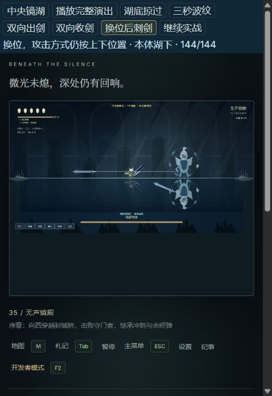

# 余烬之井 · Emberwell

原创幽暗风格的横版探索动作游戏，使用原生 JavaScript、Canvas 2D 和 Web Audio 编写。

**[在线试玩](https://emberwell-demo.validcarp16.chatgpt.site/) · [MIT 许可证](LICENSE)**

当前开源快照：**v19 / 0.19.0**，2026-10-18 发布；包含最新镜湖战斗改动。下载后即可运行，无须安装依赖。修改扩展模块后需要重新生成一次脚本包。



## 游戏内容

- 六章、81 个房间、18 种普通敌人、6 个 Boss 和 6 类 NPC。
- 前斩、上劈、空中下劈反弹、跳跃、冲刺、疗愈、空中单发余烬弹与成长系统。
- 章节机关、六处井下秘境、六条跑酷取物路线、密库和遭遇战。
- NPC 提供恢复、测绘、锻造补给、解读证词等服务；归途证词、支线和两种结局连接井城的故事。
- 主菜单、自动存档、三个手动存档位、读档、新游戏、退出页面和 17 项可修改按键。
- 开发者模式支持召唤怪物、Boss、NPC，无敌、飞行，以及地图右键传送。试验不覆盖正式存档。
- 原创 Canvas 模型、死亡动画、粒子、分层光效和各招式的合成音效。

首轮通关约两小时是设计目标，尚未通过真人全流程计时校准。

## 运行

直接打开 `index.html`，或使用 Node.js 18 及以上版本：

```sh
npm start
```

打开 `http://127.0.0.1:4173`。无需执行 `npm install`。建议使用键盘、全屏并点击右上角开启声音。

## 操作与存档

| 默认按键 | 操作 |
| --- | --- |
| A / D、← / → | 左右移动 |
| 空格 | 跳跃；长按跳得更高，解锁后可二段跳 |
| J / Z | 挥刀；配合 W / ↑ 上劈，空中配合 S / ↓ 下劈 |
| X / K / Shift | 冲刺，击败守门者后解锁 |
| F | 向前单发余烬弹，空中可用 |
| V | 空中下坠破印 |
| 长按 C / L | 疗愈，每格生命消耗 33 点余烬 |
| E | 互动；在灯台旁步行靠近并休憩 |
| B | 使用补给 |
| M | 地图；灯台传送，开发者模式可右键定位 |
| Tab / Q | 札记 |
| ESC | 主菜单 / 暂停 |
| F2 | 开发者模式面板 |

设置中可以改键。ESC 和 F2 保留为菜单与开发者入口。

存档使用当前浏览器的 `localStorage`；不同浏览器、网址和本地文件地址的存档独立。手动存档不会随自动存档更新，新游戏保留手动存档位。加载后从记录的灯台出发。

## Boss 与继承

角色开局没有 Boss 继承能力。从静息庭院向西，用普通跳跃穿过封缄桥挑战守门者。后续章节通过沿途灯印、机关与试炼推进。

| Boss | 生命 | 战斗特点 | 击败奖励 |
| --- | --- | --- | --- |
| 守门者 | 36 | 原模型与招式，冲刺和弹幕前摇明显区分 | 普通冲刺、单发余烬弹 |
| 荆冠寄主 | 54 | 地下藤刺；半血巨藤爆开成食人花，吐毒与冲撞 | 弹丸中毒，每秒 0.5 伤害持续 5 秒；二段跳 |
| 熔炉司祭 | 72 | 蓝袍红杖牵引火雨；半血炸炉，赤袍蓝杖急射火球与预警激光 | 弹速加快、直接伤害翻倍；下坠破印 |
| 镜湖残像 | 144 | 中央镜湖、湖底登场、虚实互换；湖上横刺、湖下斜刺，收剑也有伤害 | 更远的镜行冲刺，穿怪且冲刺期间免伤 |
| 深渊钟守 | 288 / 条命 | 地面钟波、预警落钟、回声弹；原地满血回生一次 | 一次满状态原地复活与 1 秒无敌 |
| 无光之王 | 576 | 锁定剑气、王冠地刺、交叉斩；半血三连斩，每斩独立预警 | 无光之剑：100 伤害、半屏距离、穿地形，每秒一斩 |

普通冲刺撞到敌人会受伤弹开；镜行冲刺才可穿过敌人。回生机会消耗后不会通过休憩补回。无光之剑优先瞄准屏幕内最近的可攻击敌人，无目标时按角色朝向挥斩。

### 镜湖 v19

无声镜殿中央是可站立的湖面，两侧保留陆地；水面倒映上方的景物和人物。走到湖心触发七秒演出：湖底左侧渐现、高速掠向右侧、淡出、三秒波纹，最后从中央上刺。前六秒固定操作与镜头，最后一秒可以移动躲避。

战斗中的本体与倒影透明度相同。倒影不受伤，本体随机与倒影交换上下位置；攻击方式始终按位置区分，上方横刺、下方斜刺，剑刃伸出与收回都可伤人。F2 选择“镜湖残像 → 湖心登场演出”可重看动画，也可直接满血或半血开战。

司祭死亡后倚杖跪地，眼火、法袍与法杖颜色逐渐消退，遗体随存档长期保留。正常模式不能清除，开发者模式可清除或重新召唤对应熔炉。

## 开发与验证

```sh
npm run build
npm test
```

375 项检查覆盖物理与地图、上下劈、单发弹丸、毒效、冲刺碰撞和无敌、存读档、Boss 奖励、六次继承、技能改键、开发者隔离、司祭遗体、镜湖演出锁定与恢复、虚实换位、刺剑伸出及回收伤害等。测试使用 Node.js 内置模块和模拟 DOM / Canvas；视觉、音效和操作手感仍需浏览器试玩。

### 文件结构

| 文件 | 用途 |
| --- | --- |
| `index.html`、`style.css` | 页面、菜单与响应式样式 |
| `game.js`、`campaign.js` | 物理、战斗、章节、地图与进度 |
| `variety.js`、`atelier.js` | 敌人、机关、合成音效与模型 |
| `thorn.js`、`lifecycle.js`、`menu.js`、`depths.js` | 食人花、死亡动画、存档、井下秘境 |
| `forge.js`、`chronicles.js` | 司祭、扩展流程与 NPC 服务 |
| `developer-core.js`、`inheritance.js` | 开发者工具与 Boss 继承 |
| `latebosses.js`、`mirrorlake.js`、`settings.js` | 后期 Boss、最新镜湖与改键 |
| `developer.js` | 上述扩展模块生成的运行脚本包，勿直接编辑 |
| `scripts/build.cjs`、`scripts/serve.cjs`、`scripts/test.cjs` | 生成、预览与检查入口 |
| `tests/`、`docs/` | 测试与游戏截图 |

HTML 按既定顺序加载基础模块，再加载 `developer.js`。修改脚本包内的源模块后运行 `npm run build`；不要把这些模块再单独加进 HTML，以免重复注册系统。

## 许可证

代码、原创绘制内容与本仓库截图使用 [MIT License](LICENSE)。本项目借鉴横版探索动作游戏的玩法类型，未使用《空洞骑士》的角色、场景、音乐或其他游戏素材。

页面通过 Google Fonts 引用 Inter 与 Noto Serif SC，字体遵循各自许可证；未连接字体服务时会使用系统字体，不影响游戏逻辑。
