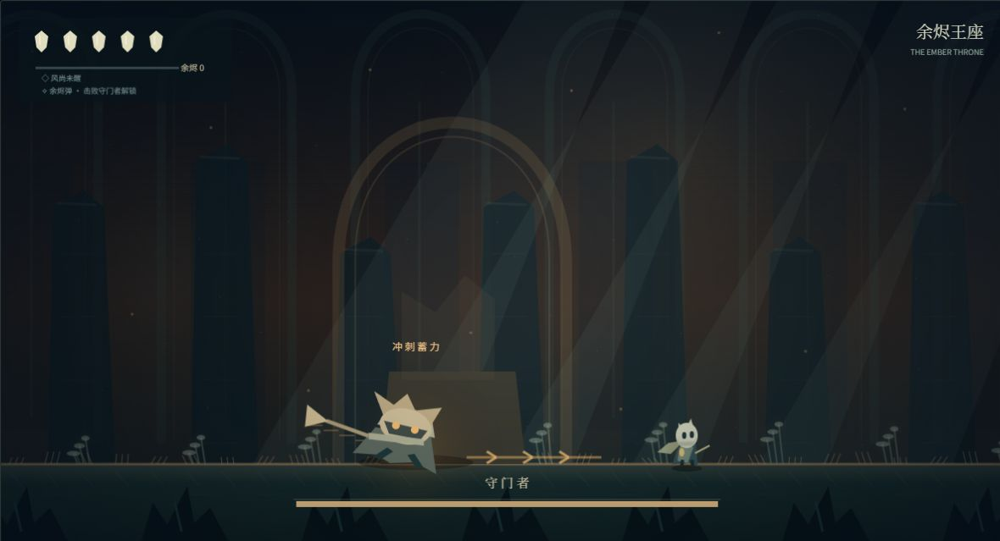
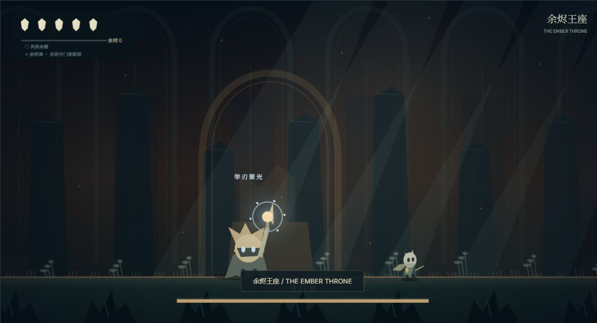

# 余烬之井 · Emberwell

原创幽暗风格的横版探索动作游戏 Demo，使用原生 JavaScript 与 Canvas 2D 编写，无构建步骤、无运行时依赖。

**[在线游玩](https://emberwell-demo.validcarp16.chatgpt.site)**

## 游戏内容

- 5 个相连区域：静息庭院、苔光回廊、风眠圣所、封缄桥、余烬王座。
- 跳跃、近战、空中冲刺、疗愈、地图、灯台存档与复活。
- 2 类普通敌人，以及具有冲刺和弹幕攻击的守门者 Boss。
- 冲刺前摇为压身拉刃与地面箭头；弹幕前摇为举刃与头顶聚光。
- 长按跳跃可一次越过 Boss，无需使用冲刺。
- 击败 Boss 后获得「余烬弹」，地面和空中均可向前发射单颗弹丸。
- Canvas 绘制的场景、角色、粒子和光效，以及 Web Audio 生成的环境音和音效。

| 冲刺蓄力 | 弹幕蓄力 |
| --- | --- |
|  |  |

## 运行

直接打开 `index.html` 即可游玩；推荐使用近期版本的 Chrome、Edge 或 Firefox。

也可以使用 Node.js 启动本地服务器：

```sh
npm start
```

然后打开 `http://127.0.0.1:4173`。无需执行 `npm install`。

页面使用 Google Fonts 的 Inter 与 Noto Serif SC；无网络时会自动使用系统字体，游戏不依赖外部图片、音频或字体下载。

## 操作

| 按键 | 操作 |
| --- | --- |
| A / D、← / → | 移动 |
| 空格、↑、W | 跳跃，长按跳得更高 |
| J / Z | 近战攻击 |
| K / X、Shift | 冲刺，需先取得风之余烬 |
| 长按 L / C | 疗愈，每格生命消耗 33 点余烬 |
| F | 余烬弹，击败 Boss 后解锁；每次单发，空中可用 |
| E | 在灯台休憩、拾取能力、阅读刻痕 |
| M | 地图 |
| ESC | 暂停 / 继续 |
| R | 返回已记录的灯台 |

触屏设备提供屏幕按钮。建议使用键盘并开启全屏。

## 探索路线

从静息庭院向东穿过苔光回廊，登上风眠圣所的平台，在发光晶体旁按 E 获得风之余烬。折返后向西进入封缄桥，利用跳跃与冲刺越过深渊，进入余烬王座挑战守门者。

胜利后按 Enter 或点击画面继续探索，使用 F 试用余烬弹。

存档使用当前浏览器的 `localStorage`，保存能力、灯台位置和通关状态。不同浏览器、网址与本地文件地址的存档独立。旧版通关存档会自动解锁余烬弹；页面底部可重置存档。

## 开发与验证

```sh
npm test
```

27 项检查覆盖跳跃、平台可达性、冲刺、伤害与无敌时间、疗愈、灯台、Boss 状态与胜利、单发弹丸碰撞、空中施法、越过静止 / 冲刺 Boss，以及旧存档兼容。

测试使用 Node.js 内置模块，在模拟 DOM 与 Canvas 环境中运行游戏逻辑。视觉和操作手感仍需在浏览器中检查。

```text
index.html           页面与控制说明
style.css            页面样式和响应式布局
game.js              游戏逻辑、Canvas 绘制与音效
scripts/serve.cjs    本地静态服务器
tests/game.test.cjs  游戏逻辑检查
docs/                游戏截图
```

## 许可证

本仓库的代码、原创绘制内容与截图使用 [MIT License](LICENSE)。玩法受到横版探索动作游戏启发，未使用《空洞骑士》的角色、场景、音乐或其他游戏素材。外部字体由 Google Fonts 提供，遵循其各自许可证。
